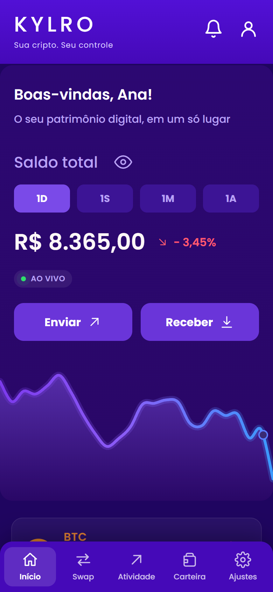
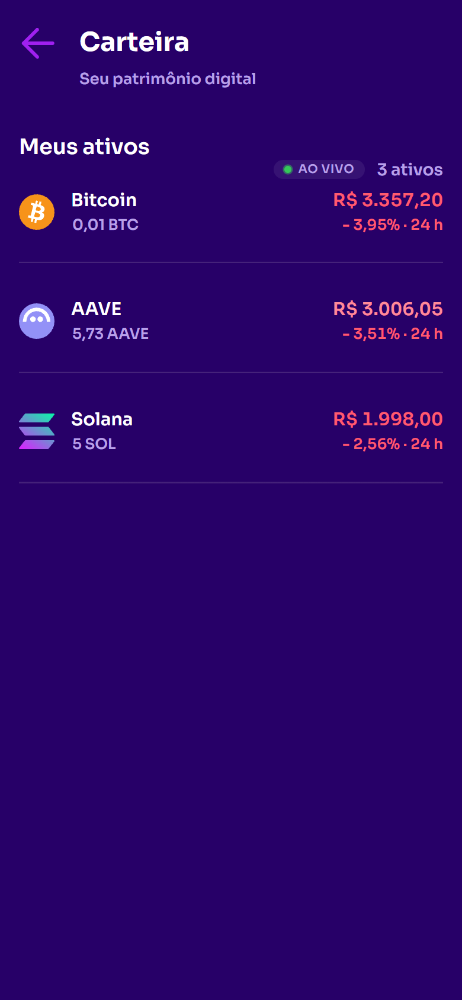
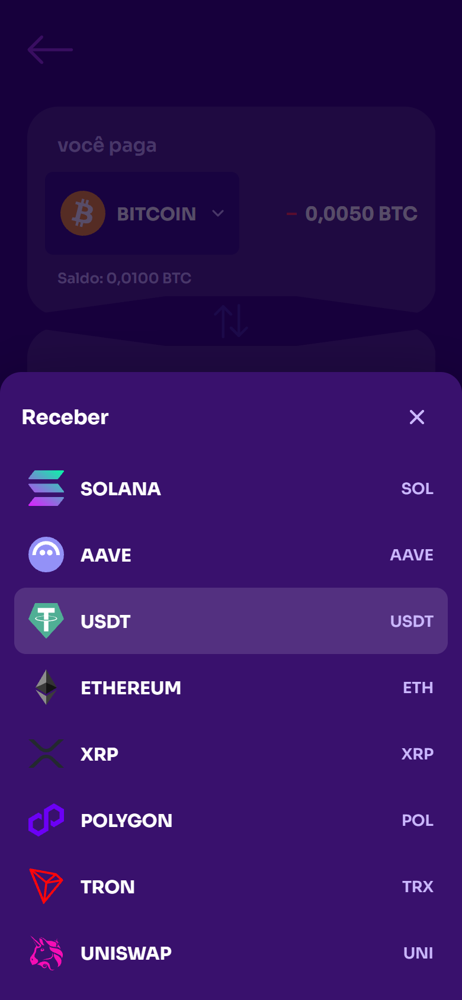

# KYLRO

Uma carteira de criptomoedas simulada, com cotações reais atualizadas ao vivo. Fiz o projeto com HTML, CSS e JavaScript puros, sem frameworks nem bibliotecas.

[Ver o site no ar](https://gustavo-s-dev.github.io/KYLRO/)

> [!IMPORTANT]
> Este é um projeto de portfólio e funciona como uma simulação. Saldo, quantidades, envios, recebimentos e trocas são fictícios: nenhuma transação financeira acontece e o site não pede nenhum dado real. Apenas as cotações são reais, vindas de APIs públicas. O nome digitado na entrada fica salvo só no navegador de quem acessa.


<table>
  <tr>
    <td align="center"><br><sub>Entrada</sub></td>
    <td align="center"><br><sub>Início</sub></td>
    <td align="center"><br><sub>Carteira</sub></td>
    <td align="center"><br><sub>Swap</sub></td>
  </tr>
</table>

## Funcionalidades

- Na primeira visita, o site pergunta o nome da pessoa e passa a usá-lo no painel. Qualquer nome é aceito, com acento, hífen ou apóstrofo; só palavrões são recusados, inclusive com letras repetidas ou separadas por espaço.
- O saldo e o gráfico da carteira acompanham o mercado segundo a segundo, com os períodos de 1 dia, 1 semana, 1 mês e 1 ano. Ao passar o mouse ou o dedo sobre o gráfico, aparecem o valor e o horário daquele ponto.
- As telas compartilham a mesma carteira. Um swap, um envio ou um recebimento simulado altera os saldos, aparece no Início e na Carteira e fica registrado na Atividade com data e hora. Na Carteira, um botão reinicia a demonstração.
- Na Carteira, cada moeda mostra o valor em reais e a variação das últimas 24 horas, em verde quando subiu e em vermelho quando caiu.
- No Swap, o pagamento é feito com as moedas que estão na carteira e é possível receber BTC, SOL, AAVE, USDT, ETH, XRP, POL, TRX ou UNI, pela cotação do momento.
- No sino de notificações dá para criar alertas de preço, como "me avise quando o BTC passar de R$ 350.000". Quando o preço é atingido, o alerta aparece no painel e, se a pessoa permitir, como notificação do sistema.
- Também há telas de envio, recebimento (com QR code), atividade e configurações.

## Como funciona

**Cotações.** A fonte principal é a API da Binance. O site busca os preços uma vez e depois recebe as atualizações por WebSocket, cerca de uma por segundo. Se a conexão cair, ele tenta reconectar e, enquanto isso, consulta os preços a cada 5 segundos. Quando a Binance não responde (algumas redes e países bloqueiam o acesso), os dados vêm da CoinGecko, consultada a cada 30 segundos. Se nenhuma das duas responder, o site mostra valores de exemplo e indica que as cotações estão offline.

**Preços em reais.** BTC, SOL e USDT têm par em reais na Binance. Para as outras moedas, como a AAVE, uso o par em dólar (por exemplo, AAVE/USDT) e multiplico pela cotação do USDT em reais.

**Estado da carteira.** Saldos e histórico ficam num único módulo (`js/core/estado.js`), salvo no `localStorage`. As telas não alteram os dados diretamente: chamam funções como `trocar`, `enviar` e `receber`, que validam o saldo, aplicam a operação inteira ou nenhuma parte dela e avisam quem está ouvindo. O evento `storage` mantém outras abas abertas atualizadas.

**Gráficos.** As curvas são desenhadas em SVG, sem biblioteca, com suavização Catmull-Rom convertida para curvas de Bézier. O gráfico principal soma, em cada ponto do período, o valor de todas as moedas da carteira. A dica do gráfico usa Pointer Events, então funciona com mouse, toque e também com as setas do teclado.

**Alertas.** A cada cotação recebida, os alertas salvos são comparados com o preço atual. Um alerta que já estaria atingido no momento da criação é recusado, e cada alerta dispara uma única vez.

**Organização.** O código usa módulos JavaScript (`import`/`export`). O que é compartilhado fica em `js/core/`: catálogo de moedas, cotações, estado da carteira, alertas, formatação e regras do nome. Cada tela tem um arquivo próprio em `js/`.

**Responsividade.** São três layouts: no computador, com menu lateral; no tablet; e no celular, com uma barra de navegação fixa na parte de baixo, como em um aplicativo.

**Acessibilidade.** Os botões que só têm ícone recebem rótulos para leitores de tela, as janelas fecham com Esc e a animação de entrada é desativada para quem ativou a opção de reduzir movimento no aparelho.

## Tecnologias

- HTML5, CSS3 e JavaScript
- WebSocket e Fetch API
- APIs públicas da [Binance](https://developers.binance.com/docs/binance-spot-api-docs) e da [CoinGecko](https://docs.coingecko.com/)
- SVG para gráficos e ícones
- GitHub Pages, com publicação pelo GitHub Actions

## Estrutura

```
index.html          início: saldo, gráfico e moedas
carteira.html       ativos com valor em tempo real
swap.html           troca entre moedas
enviar.html · receber.html · atividade.html · configuracoes.html
css/                um arquivo de estilo por página
js/
  core/
    moedas.js       catálogo das 9 moedas (nome, logo, cores, endereço de exemplo)
    estado.js       saldos e histórico da carteira
    cotacoes.js     cotações ao vivo e histórico dos gráficos
    alertas.js      alertas de preço e notificações
    formato.js      valores, datas e números no padrão brasileiro
    nome.js         regras do nome e filtro de palavrões
    sessao.js       "Sair": apaga nome, carteira e alertas
  inicio.js         início: saldo, gráfico interativo e moedas
  notificacoes.js   painel do sino e formulário de alertas
  tela-nome.js      tela que pergunta o nome
  splash.js         animação de entrada
  ...               um arquivo por página
img/                logos das moedas e ícones
docs/prints/        imagens deste README
```

## Como executar

O projeto não tem dependências, mas precisa ser servido por HTTP: os navegadores não carregam módulos JavaScript abertos direto do disco (`file://`). Qualquer servidor estático serve:

```bash
git clone https://github.com/gustavo-s-dev/KYLRO.git
cd KYLRO
python -m http.server 8000   # depois abra http://localhost:8000
```

## Autor

Gustavo Silva · [github.com/gustavo-s-dev](https://github.com/gustavo-s-dev)
