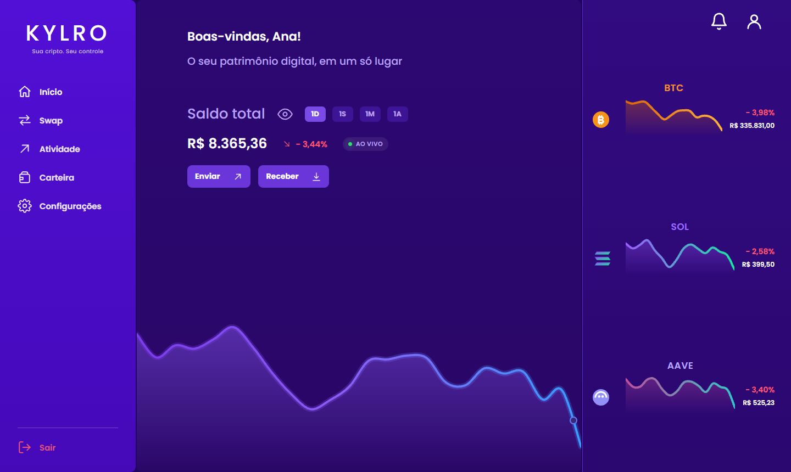
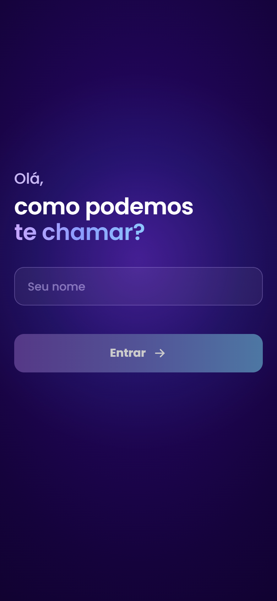

# KYLRO — carteira de criptomoedas (simulação)

**Sua cripto. Seu controle.** Uma carteira de criptomoedas responsiva, feita com HTML, CSS e JavaScript puros, que mostra cotações reais em tempo real.

**[Ver o site no ar →](https://gustavo-s-dev.github.io/KYLRO/)**

> [!IMPORTANT]
> **Este projeto é uma simulação, feita para portfólio.** O saldo, as quantidades de cada moeda, os envios, os recebimentos e as trocas (swap) são fictícios. Nenhuma transação acontece de verdade e o site não pede nenhum dado real. **Só as cotações são reais**, vindas de APIs públicas. O nome digitado na entrada fica salvo apenas no seu navegador.



<table>
  <tr>
    <td align="center"><br><sub>Entrada: pergunta o nome</sub></td>
    <td align="center"><br><sub>Início com saldo ao vivo</sub></td>
    <td align="center"><br><sub>Carteira em tempo real</sub></td>
    <td align="center"><br><sub>Swap com 9 moedas</sub></td>
  </tr>
</table>

## O que dá para fazer

- **Entrar com o seu nome.** Na primeira visita o site pergunta como te chamar e usa o nome no painel. Aceita qualquer nome (com acento, hífen ou apóstrofo) e recusa só palavrões, mesmo disfarçados ("PORRRA", "pu ta").
- **Acompanhar o saldo ao vivo.** O valor da carteira e o gráfico mudam a cada segundo conforme o mercado, com períodos de 1 dia, 1 semana, 1 mês e 1 ano.
- **Ver a carteira em tempo real.** Cada moeda mostra o valor em reais, em verde quando subiu e em vermelho quando caiu nas últimas 24 horas.
- **Simular trocas (swap).** Você paga com o que tem na carteira (BTC, SOL ou AAVE) e escolhe o que receber entre 9 moedas (USDT, ETH, XRP, POL, TRX, UNI e as outras da carteira). A conversão usa a cotação do momento.
- **Navegar pelas outras telas:** enviar, receber (com QR code), atividade e configurações.

## Como funciona por dentro

- **Cotações em tempo real.** A fonte principal é a API da Binance: o site lê os preços uma vez e depois recebe atualizações a cada segundo por **WebSocket**. Se a conexão cair, ele reconecta sozinho e, enquanto isso, consulta o preço a cada 5 segundos.
- **Plano B e plano C.** Se a Binance não responder (algumas redes e países bloqueiam), o site usa a **CoinGecko**, atualizada a cada 30 segundos. Se nenhuma das duas responder, mostra valores de exemplo e avisa "cotações offline".
- **Moedas sem par em reais.** AAVE e as moedas novas do swap não são negociadas em reais na Binance. O preço em reais é calculado multiplicando o par em dólar (ex.: AAVE/USDT) pelo USDT em reais.
- **Gráficos sem biblioteca.** As curvas são desenhadas em SVG, com suavização Catmull-Rom → Bézier, e o gráfico principal soma o valor de cada moeda da carteira em cada ponto do período.
- **Responsivo de verdade.** Três layouts: computador (menu lateral), tablet e celular (barra de navegação fixa embaixo, como num aplicativo, com botões de pelo menos 44px para o toque).
- **Atualização garantida.** Os links de CSS e JS levam um número de versão (`?v=`), para o navegador baixar os arquivos novos depois de cada publicação.
- **Acessibilidade.** Rótulos para leitores de tela, navegação por teclado (Esc fecha janelas) e entrada sem animação para quem ativou "reduzir movimento" no aparelho.

## Tecnologias

- HTML5, CSS3 e JavaScript (sem frameworks e sem bibliotecas)
- WebSocket e Fetch API
- APIs públicas da [Binance](https://developers.binance.com/docs/binance-spot-api-docs) e da [CoinGecko](https://docs.coingecko.com/)
- SVG para gráficos e ícones
- GitHub Pages com publicação automática pelo GitHub Actions

## Estrutura

```
index.html          início: saldo, gráfico e moedas
carteira.html       ativos com valor em tempo real
swap.html           troca entre moedas
enviar.html · receber.html · atividade.html · configuracoes.html
css/                um arquivo de estilo por página
js/
  script.js         início: cotações, saldo e gráficos
  cotacoes.js       cotações ao vivo usadas pela carteira e pelo swap
  nome.js           tela do nome e filtro de palavrões
  splash.js         animação de entrada
  ...               um arquivo por página
img/                logos das moedas e ícones
docs/prints/        imagens deste README
```

## Rodar no seu computador

Não precisa instalar nada. Baixe o projeto e abra o `index.html` no navegador, ou sirva a pasta com qualquer servidor estático:

```bash
git clone https://github.com/gustavo-s-dev/KYLRO.git
cd KYLRO
python -m http.server 8000   # depois abra http://localhost:8000
```

## Autor

Feito por **Gustavo Silva** — [github.com/gustavo-s-dev](https://github.com/gustavo-s-dev)
